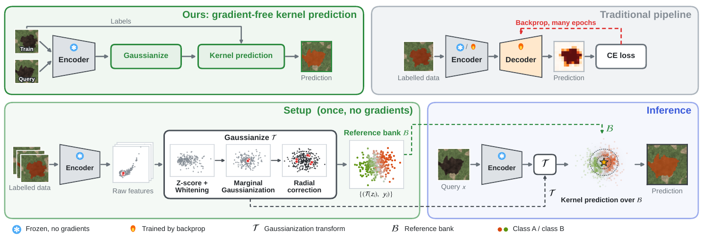

<div align="center">

# From Frozen Features to Gaussian Token Spaces: Gradient-Free Kernel Prediction for Earth Observation

[](https://arxiv.org/abs/xxxx.xxxxx)
[](https://pytorch.org/get-started/locally/)

**Dominik J. Mühlematter**<sup>1,2*</sup>, **Philip Janz**<sup>1,2</sup>, **Xue Xia**<sup>1</sup>, **Konrad Schindler**<sup>2</sup>, **Helge Aasen**<sup>1</sup>, **Mehmet Ozgur Turkoglu**<sup>1*†</sup>

<sup>1</sup> Agroscope, Earth Observation of Agroecosystems, Zurich, Switzerland<br>
<sup>2</sup> ETH Zurich, Switzerland<br>
<sup>*</sup> Equal contribution · <sup>†</sup> Corresponding author (moturkoglu@gmail.com)

</div>

## Abstract



To make use of Earth observation (EO) foundation models, users must train task-specific decoders, and often also fine-tune the foundational encoder for their task. This adds computational cost and can lead to overfitting when labelled examples are scarce. We propose an alternative way to employ pretrained foundation models: we show that one can, without any gradient-based optimisation, reorganise the geometry of the pretrained feature space such that it becomes decodable with elementary predictors. Using ideas from self-supervised feature learning, we warp the feature space to give it isotropic Gaussian structure, and show that in the transformed space accurate predictions can be made with simple kernel-based prediction. The principle generalizes across different EO foundation models and makes it easy to integrate additional features such as DINOv3, as well as classical spectral indices.

Our approach is computationally very cheap and takes only a few minutes to set up. Across multiple EO benchmarks, its performance is comparable to the state of the art (sometimes even better). Moreover, it remains effective in data-scarce and few-shot settings.

## Installation

Create a Python 3.12 environment on a machine with a CUDA GPU that supports bfloat16. The example uses CUDA 12.8 on Linux. Select a build that matches your GPU driver using the PyTorch badge above.

```bash
python3.12 -m venv .venv
source .venv/bin/activate
python -m pip install torch==2.11.0 torchvision==0.26.0 --index-url https://download.pytorch.org/whl/cu128
python -m pip install -r requirements.txt
```

Download and extract [MADOS](https://zenodo.org/records/10664073). Use the directory containing `Scene_*` and `splits/` as `--data-root`. Download `model.safetensors` from the [timm DINOv3 ViT-L/16 LVD-1689M model](https://huggingface.co/timm/vit_large_patch16_dinov3.lvd1689m) and pass its path to `--checkpoint`.

## How to run

```bash
python run_mados.py --data-root /path/to/MADOS --checkpoint /path/to/model.safetensors --predictor cosine
python run_mados.py --data-root /path/to/MADOS --checkpoint /path/to/model.safetensors --predictor kernel
```

## Citation

Please cite our paper if you use this work or code.

```bibtex
@misc{muehlematter_gaussian_token_spaces,
  title  = {From Frozen Features to {Gaussian Token Spaces}: Gradient-Free Kernel Prediction for {Earth Observation}},
  author = {M{\"u}hlematter, Dominik J. and Janz, Philip and Xia, Xue and Schindler, Konrad and Aasen, Helge and Turkoglu, Mehmet Ozgur}
}
```
